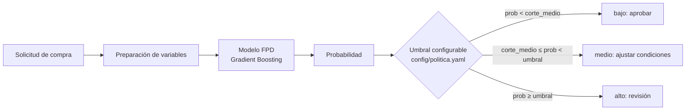

# Predicción de First Payment Default (FPD) — Cashea

Proyecto final de Ciencia de Datos Aplicada (ITBA).
Servicio que estima la probabilidad de que un cliente caiga en **FPD** (más de 3 días de atraso en la primera cuota) en el momento de aprobar una compra en cuotas.

> **El modelo estima el riesgo; el negocio decide cuánto riesgo asumir.**

## Cómo funciona



El modelo devuelve una probabilidad. Una **política** aparte, configurable, la traduce en una acción:

| Banda | Condición | Acción |
|---|---|---|
| bajo | `prob < corte_medio` (0,1001) | `aprobar` |
| medio | `corte_medio ≤ prob < umbral` | `ajustar_condiciones` (menos cuotas, más anticipo, menor monto) |
| alto | `prob ≥ umbral` (0,155) | `revision` |

**Subir el umbral = aprobar más** (por ejemplo, en Black Friday). **Bajarlo = más conservador.**

## Estructura y responsables

| Carpeta | Contenido | Responsable |
|---|---|---|
| `src/`, `api/`, `config/`, `modelo/` | Modelo, política de decisión y API (FastAPI) | Persona A |
| `app/` | Interfaz (Streamlit) que consume la API | Persona B |
| `notebooks/`, `datos/`, `docs/` | Análisis (sensibilidad, bandas, matriz de confusión), documentación y presentación | Persona C |

## Cómo correr todo

Versiones: **Python 3.13** y **scikit-learn 1.6.1**, las mismas del entorno donde se guardó el modelo (`modelo/modelo_fpd_cashea.joblib`). No se reentrena nada.

```bash
python3.13 -m venv .venv
source .venv/bin/activate          # Windows: .venv\Scripts\activate
pip install -r requirements.txt
```

**1. API y tests**
```bash
pytest -q
uvicorn api.main:app --reload      # http://127.0.0.1:8000/docs
curl -X POST http://127.0.0.1:8000/predecir -H "content-type: application/json" -d @scripts/ejemplo_solicitud.json
```
API desplegada: https://cashea-fpd-api.onrender.com (`/docs`, `/health`). En el plan gratuito de Render la primera respuesta puede tardar 1 o 2 minutos.

**2. Interfaz**
```bash
pip install -r app/requirements.txt
API_URL=http://127.0.0.1:8000 streamlit run app/app.py     # o MODO_MOCK=1 para probar sin API
```

**3. Análisis (notebook)**
```bash
pip install jupyter
cd notebooks && jupyter notebook Entregable_final_cashea.ipynb
```
El notebook usa solo archivos de `datos/` y corre de arriba abajo sin el Colab.

| Archivo en `datos/` | Qué es |
|---|---|
| `validacion_fold2_gb.csv` | Predicciones fuera de muestra de validación (enero, fold 2) |
| `sensibilidad_validacion.csv` | Tabla por umbral, de 0,05 a 0,40 (la sirve `GET /sensibilidad`) |
| `test_predicciones_gb.csv` | Predicciones del modelo guardado sobre test (febrero–marzo) |
| `ejemplos.json` | 3 solicitudes reales de test (bajo, medio y alto), en formato crudo |

Detalle de endpoints, contrato y errores: [`api/LEEME.md`](api/LEEME.md).

## Resultados

- Modelo: Gradient Boosting, 12 variables del Entregable 2 + el riesgo histórico del comercio. **AUC test 0,676** (validación cruzada temporal: 0,667).
- Umbral **0,155** y `corte_medio` **0,1001**, fijados en validación (enero). El test no se usó para elegir nada.
- En test con umbral 0,155: rechazo **8,0%**, FPD evitado (recall) **19,4%**, precision **18,2%**.
- La matriz de confusión depende del umbral; el AUC no, porque mide el orden de las probabilidades sobre todos los umbrales a la vez.

## Integración operativa y gobierno del modelo

**Separación modelo / política.** El modelo solo produce una probabilidad. El umbral y el corte medio viven en `config/politica.yaml`, no en el código del modelo. Cambiar la política no requiere reentrenar ni volver a desplegar el modelo, y cada respuesta de la API informa `version_modelo` y `version_politica`.

**Quién cambia el umbral.** Lo decide el área de negocio/riesgo, no quien mantiene el modelo. El cambio se hace con `PUT /politica` indicando `usuario` y `motivo`, y queda registrado en `logs/cambios_politica.csv`. La API rechaza un umbral menor al corte medio. Para elegirlo, se usa la tabla de sensibilidad (`GET /sensibilidad`), que muestra qué pasa con el rechazo, el FPD evitado y el FPD de los aprobados en cada umbral.

**Monitoreo mensual.**

| Qué se mira | Para qué |
|---|---|
| AUC con los FPD que ya maduraron | Detectar si el modelo perdió poder de ordenamiento |
| PSI de las variables y de la probabilidad | Detectar cambios en la población que llega |
| Calibración por segmento (por ejemplo, vertical, cuotas, primera compra) | Ver si la probabilidad predicha coincide con la tasa observada en cada grupo |

**Cuándo reentrenar.** Si el **PSI supera 0,10**, se reentrena. Al hacerlo hay que recalcular también el `corte_medio` (sale del percentil 70 de la validación) y volver a evaluar el umbral con la tabla de sensibilidad. El umbral de alerta para el AUC y para la calibración lo define el área de riesgo.

**Limitaciones conocidas.**
- El AUC (0,676) es moderado: el modelo ordena mejor que el azar, pero la precision es baja (18%).
- El costo de un FN vs. un FP (5:1) es un supuesto ilustrativo, no un dato de Cashea.
- En el plan gratuito de Render el disco se borra al reiniciar: se pierden los logs y los cambios de política. En producción irían a una base de datos.
